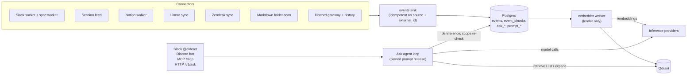

# Diderot design

This document describes Diderot as it is built. Settings are listed in the
[configuration reference](configuration.md).

## Overview

Diderot answers questions about an organization's written knowledge.
Connectors ingest Slack, Discord, coding-agent sessions, Notion, Linear,
Zendesk, and a folder of Markdown files into one typed Postgres event log. An embedder worker chunks and embeds
every event into Qdrant. An agent loop answers questions by calling
retrieval tools over that corpus, plus optional web, code, and MCP tools,
and replies with citations. People reach it through `@diderot`
in Slack, the bot in Discord, and MCP; administrators run it from the
browser at `/admin`.

Retrieval is **vector-only**. The question is embedded, Qdrant returns
approximate nearest neighbours by cosine distance under a mandatory
permission filter, results are deduplicated per event, and Postgres supplies
the matched text. There is no reranker and no lexical (BM25) leg.

## Sources

| `events.source` | Connector | How it arrives |
|---|---|---|
| `slack` | `internal/connector/slack` | Socket Mode live events, plus a continuous sync worker (channel tail and thread sweeps) as the correctness backstop. Hosted image, PDF, DOCX, and XLSX attachments add caption and document-text chunks. |
| `agent_session` | `internal/sessioningest` | Session documents from a session feed or HTTP push, decoded into records and summarized with map and reduce prompts. See [Session ingest](session-ingest.md). |
| `notion` | `internal/connector/notion` | A walker over operator-declared root pages, plus Search-API discovery. |
| `linear` | `internal/connector/linear` | Incremental sync, an hourly sweep that removes issues that moved to private teams, and a daily reconcile. |
| `zendesk` | `internal/connector/zendesk` | Tickets, individual comments, Help Center articles, and attachment text. Only tickets in configured groups are indexed. A ticket that moves out of them is removed. |
| `discord` | `internal/connector/discord` | The chosen channels of every server the bot is in: a REST read of each channel's and public thread's history, gateway events for live messages, edits, deletes, reactions and threads, a tail every five minutes after each stream's newest message, and a daily re-read of the last seven days. Channels and who may read each are chosen on the connector's page. |
| `markdown` | `internal/connector/markdown` | A scan, every rescan interval, of the folder the deployment mounts at `DIDEROT_MARKDOWN_DIR`: one event per Markdown file, keyed by its path. After a scan that read the whole folder, the events of files that are gone are removed. |

Source identifiers are sticky: they appear in migrations, indexes, retrieval
filters, the tools' `sources` enum, and tests.

## Architecture

### Processes and leadership

Every replica serves HTTP and answers Ask over the API and MCP
([Replicas](#replicas)). Work that must run once per deployment runs only on
the leader: the Slack connector, the embedder, connector syncs, session
ingest, scheduled reports, PagerDuty investigations, and the delete and
scope workers.

- **Kubernetes** (`DIDEROT_LEADER_BACKEND=kubernetes`): a Lease with a 15s
  term (`internal/leader`). During a rolling update the lease moves from the
  old pod to the new one. A pod that loses its Lease contends again once its
  leader work has stopped.
- **Postgres** (`DIDEROT_LEADER_BACKEND=postgres`, the default when
  standalone): a session advisory lock held on one dedicated connection. The
  holder re-checks the lock every 2s and cancels its leader context when a
  check fails, or does not finish within 4s of the start of the last check
  that succeeded. The server ends a silent lock session
  after 15s (`idle_session_timeout`). A new holder waits 9s after acquiring
  before it starts, so a deposed leader has stopped before its successor
  begins. There are no fencing tokens: a process frozen past the session
  timeout can act once on waking before it notices. A process that loses the
  lock contends again once its leader work has returned.

An election that cannot start, which no retry fixes (a pod without its
service account credentials, a database older than Postgres 14), stops
`serve` with the reason rather than leave a replica that serves requests and
never leads. Failures once an election runs, lost terms included, are retried.

`serve` listens on a public port (default `:9091`), a machine port (default
`:9092`) that refuses the browser routes, a PagerDuty webhook port
(default `:9093`), which answers 404 while the PagerDuty connector is
disabled, and
a metrics port (default `:9094`), the only one that serves `/metrics` and
`/debug/pprof/`.

### Starting and stopping

`serve` (`runServe` in `cmd/diderot/serve.go`) starts a replica in stages,
each building what the later ones take:

1. **Configuration** (`loadServeConfig`): the environment, the deployment
   check, and the authorization policy. No model is configured here:
   providers, models and the embedding model are settings, which the model
   catalog reads once they load. Nothing is connected yet.
2. **Database** (`openDatabase`): pending migrations, which replicas
   starting together serialize on Atlas's advisory lock, within two
   minutes; then the connection pool.
3. **Connectors** (`loadConnectors`): every source, tool, and automation,
   and the settings store, loaded and then polled for changes. Then the
   authenticators (`configureServerAuth`) and the listener for changes to
   public Slack channels.
4. **Corpus** (`preparePrompts`, `newCorpusReaders`, `followEmbedding`):
   the prompt catalog, seeded and watched; and what reads the corpus: the
   retriever, the source expander, and the reference resolver. The
   retriever follows the saved embedding model: once one is chosen it opens
   its Qdrant collection, checked with one call that names any TLS setting
   that doesn't match the server, created or validated, and until then
   search answers that it is not set up. A server with no model is healthy
   and ready.
5. **Routes and listeners** (`startReadiness`, `mountAdminAPI`,
   `mountBrowserUI`, `attachFileStorage`, `mountCorpusMCP`,
   `startListeners`): object storage attaches to the file proxy and the MCP
   `attachment` tool, and every route is mounted before a listener opens.
   Then the replica's Ask starts building (`startReplicaAsk` in
   `cmd/diderot/replica_ask.go`).
6. **Leadership** (`startLeaderElection`): while the replica leads, it runs
   leader terms (`runLeaderTerm` in `cmd/diderot/leader_term.go`).
7. **Shutdown** (`waitForStop`, `shutDown`): on SIGINT or SIGTERM the
   replica starts no new Ask turn, and each connection closes once it has
   answered its request in progress. The work in progress then has until
   one deadline, 14½ minutes on (the Slack consumer's own bound), to
   finish: the leader's work drains, and then the replica waits for its Ask
   turns, MCP `ask` tasks among them, while the listeners still serve
   requests, so a `/v1/ask` can write its answer and `tasks/get` keeps
   answering. At the deadline the Ask turns left are cancelled and given 5
   seconds to end. Then the listeners shut down, giving the requests in
   progress 10 seconds before their connections are closed, so no request
   but an Ask turn holds the shutdown longer; that leaves 15 seconds of a
   15-minute termination grace. A listener that fails, or an election that
   cannot start, stops `serve` at once.

A **leader term** builds its work from the models the roles use, and the
embedding model's collection, as it starts; a saved change to them ends the
term and starts another. Without an embedding model the embedder and the
scope and Qdrant delete workers are off for the term. It takes
the replica's Ask for its Ask model, waiting while the replica builds it,
and builds the title, embedder, and caption workers, push ingest's worker,
scheduled reports, the connector supervisor, and the scope and Qdrant
delete workers, and the re-embed worker, all under one worker supervisor.
While they run, the term lends itself (its models, its Ask, and session
ingest) to the Slack and session feed sources. Once every worker has
stopped, it takes that back and lets its Ask go, so the next term starts
from nothing.

A **re-embed** is requested on any replica and run by the leader. The
request is a queued `admin_jobs` row (`internal/reembed/job.go`), one at a
time; the leader's worker claims it, runs it, and saves its progress and
outcome to the row, which is what the Operations jobs page reads. A
queued row waits as long as it takes for a leader to claim it; a run cut
short when its term ends is recorded as canceled, and one whose process
died reads as stalled once its heartbeat expires, until the next request
fails it. The request names the sources to rebuild, or none for every
source the driver has a rebuilder for (Slack today); the page offers a
source only while its connector is on, since rebuilding an event asks the
running connector about it.

A re-embed runs alongside live ingest for the same source, so a row it
read in its batch SELECT can be edited or deleted before it gets around
to rewriting that row. Its write is conditional on the row being
unchanged since that read (`events.Event.CheckUnchangedSince`, compared
against `updated_at` under the same row lock Upsert already takes); a row
that changed in that window is left alone and counted toward the job's
skipped count instead of being overwritten with the stale snapshot.

Two more jobs use `admin_jobs` and run, detached, on the replica that took
the request (`internal/adminapi/image_jobs.go`, `document_jobs.go`): a
rebuild of the image rows of one Slack channel or all of them, and a rebuild
of the extracted documents of every channel with document indexing on, which
deletes what was extracted and queues the documents for the document workers
again.

## Data model

### `events`

There is one row per user-visible item, unique on `(source, external_id)`.
Important columns:

- `body`, `title`, `url`, `raw` (the source-native payload)
- `actor`, `actor_id`, and `actor_canonical`, a cross-source identity, so
  one actor filter spans all sources
- `thread_id`, `occurred_at`, `deleted`
- `scope`, the permission boundary that retrieval enforces (see
  [Permissions](#permissions))
- `content_hash`, which lets the sink skip a re-ingest that changed nothing,
  so it costs no embedding
- `embedding_text`, which replaces `body` as the chunker input when set
- `session_id`, `record_start`, and `record_end` for `agent_session` rows.
  The record range is the stable handle for expansion.

Source-specific data lives in side tables such as `slack_message_details`,
`event_images`, `event_documents`, and the `notion_*`, `linear_sync`, and
`zendesk_*` tables.

Edits are in-place updates. The event's chunks are deleted and rebuilt, so
the chunk count always matches the new content. A delete sets
`deleted = true`, blanks the body, and deletes the chunks in the same
transaction.

### `event_chunks`

`event_chunks` holds the text slices sent to the embedder:

- `content` and `context_prefix`
- `kind`: `text`, `image_caption`, or `document_text`
- `event_document_id`, so replacing one attachment never erases a sibling's
  chunks
- `occurred_at`
- `embedded_at` and `embedder_id`
- `failure_count`, `last_failure`, and `last_failed_at`
- `queued_at`
- `scope_sync_*`, bookkeeping for the scope-patch worker

The Qdrant point ID is `event_chunks.id`.

**Chunking** (`internal/chunk/chunk.go`): a body of up to 1500 runes becomes
one chunk. Longer bodies are cut into windows of about 1000 runes with 200
runes of overlap, broken at whitespace within a 64-rune lookback. Every
source uses this chunker. Attachment text is split into sections first
(`internal/attachments/docs/split.go`).

**Context prefix.** The embedder embeds `context_prefix + "\n\n" + content`
(`internal/embedder/worker.go`). The prefix gives a short chunk enough topic
and author context to be found:

| Source | Prefix |
|---|---|
| Slack | Channel name, an excerpt of the thread root for replies, and `by @<actor>` when the author resolves. At most 250 runes (`internal/connector/slack/prefix.go`). |
| Notion | Page title and preface. |
| agent_session | The summary's context hint, or `session <id> records [start,end)` for record chunks (`internal/sessioningest/publish.go`). |

Changing a prefix builder or a chunker parameter needs a re-embed (**Start
re-embed** on the Operations page) to reach existing rows.

**Poison rows.** The unembedded-queue index leaves out rows with
`failure_count >= 5`, so a chunk the embedding model rejects cannot stall
the queue. The image-caption and document-extraction queues use the same
pattern. The Operations Failures page (`/admin/operations/failures`) lists
these rows by cause; for a cause outside the item itself, such as a rate
limit, **Retry** resets their attempts so the workers take them again.
Agent sessions whose summary failed are listed there too, with the same
five-attempt budget ([session-ingest.md](session-ingest.md#indexing-failures)).

Each of the three queues records a failed attempt in one statement: the
count, the error (`last_failure`), and when it happened (`last_failed_at`,
by the database's clock). The time is written and cleared with the error,
so it is the time of the error the row shows. A failure recorded before
the column existed has no time, and the page shows none for it rather than
another date from the row. Recording an item again from its source is not
a retry: a row that gave up stays that way until **Retry**.

Each row also records when it entered its queue (`queued_at`): when it was
created, and again whenever it is put back (**Retry**, a re-embed,
describing an image again). The Status page calls a queue stalled when an
item has waited more than 15 minutes without one attempt while nothing in
the queue finished. It reads that wait from `queued_at`, never from the age
of the item's event, and an item that has failed an attempt counts as being
worked on: it is listed under Failures while it is retried.

## Embedding and Qdrant sync

- **Model.** The embedding model chosen on the Models page
  ([Inference providers](#inference-providers)), called through its
  provider's OpenAI-compatible `/embeddings` endpoint
  (`internal/embedder/embedder.go`). The dimension its first call returned
  sizes the Qdrant collection, and every returned vector is checked against
  it. No query or document instruction prefix is applied. Until one is
  chosen, chunks wait unembedded and search answers that it is not set up.
- **Worker** (leader only, `internal/embedder/worker.go`):
  1. Poll for unembedded chunks every 2s, with exponential backoff on
     errors.
  2. Embed without holding database locks.
  3. Lock the rows that still exist.
  4. Upsert to Qdrant with a 30s deadline.
  5. Stamp `embedded_at` and the exact scope written, then commit.

  A delete either wins before the lock or queues a Qdrant delete afterwards.
  A crash between the upsert and the commit only repeats the idempotent
  upsert. The Qdrant write always comes before the SQL marker, so a row is
  never marked embedded before its vector exists.
- **Collection.** Named after the model and dimension when the model is
  chosen, or an existing one adopted then, so another model selects a new
  collection, which choosing it fills by marking every chunk unembedded.
  The collection uses
  cosine distance, int8 scalar quantization kept in RAM, float32 originals
  and payload on disk, and an HNSW graph in RAM (`m=16`,
  `ef_construct=100`). Shard and replica counts come from configuration and
  are checked against an existing collection (`internal/qdrantstore`).
- **Payload.** `{event_id, source, actor_id, actor_canonical, occurred_at,
  thread_id, scope}`, with indexes on `source`, `actor_id`,
  `actor_canonical`, `occurred_at`, and `scope`. A field used as a retrieval
  filter must be in the payload and indexed.
- **Deletes.** An `AFTER DELETE` trigger on `event_chunks` writes each point
  ID to `qdrant_delete_queue` in the same transaction. A leader-only worker
  applies at most 1,000 deletes per minute, with backoff. A scope change
  marks only the affected chunks (`scope_sync_needed`), and a bounded worker
  patches their payloads. Nothing scans the whole collection periodically.
  `diderot qdrant-audit` is an explicit one-off audit that queues orphan
  deletes, scope repairs, and re-embeds of missing points.

Keep bulk Qdrant work bounded and incremental. A large payload rewrite can
trigger segment rebuilds that load the whole Qdrant cluster, including any
other tenants on it.

## Connector settings

Connectors configured in the admin UI keep one row each in
`connector_settings` (`internal/settings`): non-secret settings, secrets,
an enabled flag, the last test, and a version that every write bumps. The
ingest connectors are `slack`, `notion`, `linear`, `zendesk`,
`session_feed`, `markdown`, and `discord`. Three rows are not connectors:
`org` (the organization and the setup state), `models` (each job's model
and Ask's limits), and `session_summaries` (when a finished agent session
is summarized, and when a growing one is summarized again, set under
Operations, Jobs and maintenance). The leader's session ingest reads that
last row from its settings cache for each session it considers, so a saved
change applies within one settings poll. Summaries run once a model is chosen for both session summary jobs, unless
an administrator has paused them with the switch on the same page.

- **A connector** is a `settings.Definition`: its fields (which generate its
  page at `/admin/connectors/{name}`), validation, and a Test. It is one of
  three kinds, each with its own interface and registry: a **source**
  (`internal/source`) writes to the corpus; a **tool** (`internal/asktool`:
  web search, `tavily`, and code search, `sourcebot`) gives Ask tools; an
  **automation** (`internal/automation`: PagerDuty) runs Ask in response to
  something and delivers the answer. A `settings.Registry` holds them all,
  sources then tools then automations, the order pages list them, and refuses a secret field that is also a prompt variable.
- **Secrets** come from the field's fixed variable,
  `DIDEROT_<CONNECTOR>_<FIELD>` (`settings.EnvName`), read at startup, or
  else from a value pasted on the page and stored as AES-256-GCM ciphertext
  under `DIDEROT_CONFIG_KEYS`. A set variable wins, and its field takes no
  pasted value. Pages, audit entries, test reports, logs, and prompt
  variables carry only where a secret comes from, never its value.
- **Test** runs against the form, saved or not, read-only and within 30
  seconds, and writes nothing. **Save** writes the settings and then tests
  what it wrote, storing that report as the row's last test; fields the test
  discovers (Slack's workspace name and host) are saved with a passing one.
  **Turn on** (**Save and turn on** before a connector's first save) is a save
  that also turns the connector on when its test passes. A failing test
  never turns a connector off and never discards what was saved, so a pasted
  token survives a failed attempt; an enabled connector runs its saved
  settings, and its page says when they failed their last test.
- **Every write** checks the version the writer loaded, bumps it, and records
  old and new non-secret values (and "changed" for secrets) in
  `admin_audit_log` in the same transaction.
- **Every replica** caches all rows, with their secrets read, and polls each
  row's version every 15 seconds; request paths read the cache (Slack's
  workspace host for links, the bot token for callers' private-channel
  scopes, the Slack channel controls and operator notifier, Ask's web and
  code tools, the PagerDuty
  webhook's signing secrets, the session feed's client for expanding its sessions and for Ask
  usage accounting, its viewer for links, prompt variables). On the leader a
  `settings.Supervisor` runs each enabled source's and automation's Run in
  its own context, and when the cached version changes or the connector is
  disabled, cancels it, waits for its workers, and starts it again with the
  new settings.
- **Each source** implements `internal/source`'s `Source`: its facts, its
  Run, and its expand. `cmd/diderot/sources.go` lists the sources once; the
  supervisor, expand, the `retrieve` and `list` tools' `sources` filters,
  actor identity, the setup pages, the caption worker, and the
  `{{SOURCES}}` prompt variable all read that list. Expand checks every
  event against the caller's scopes before its source reads it; Slack,
  Zendesk and pushed sessions also filter what they return around it.
  [Adding a source](adding-a-source.md) describes the interface.
- **A source's own state** (`source.Deps.State`) is a JSON value per key in
  `source_state`, kept across runs and replicas: Zendesk's pending backfill
  and the workspace Linear's sync state belongs to are there. Credentials for
  another Linear workspace clear Linear's watermark and any backfill in
  progress before its sync starts; Notion already starts discovery over
  when its integration changes. The older sources' cursors stay in their
  own tables.
- **Optional interfaces** give every source the same page:
  a `StatusReporter` (source or automation) says what it waits for and
  shows status rows (Notion, Linear, Zendesk, the session feed, the
  Markdown folder; PagerDuty's wait); a `Backfiller` describes a backfill with optional text
  arguments and records a request for its Run (Notion's walk, Linear's
  issues, Zendesk's tickets and articles), which the page's form
  requests; a `SectionProvider` names a section of its own that the
  admin UI renders (Slack's channel counts, with the channels on a page of
  their own; Notion's managed roots).
- **Each Run** holds every worker of its source. Notion's, Linear's, and
  Zendesk's live in their connector packages; Slack's and the session
  feed's in `cmd/diderot`, with what the leader term lends them. Notion's
  holds the sync worker (discovery, the daily walk of the
  managed roots, backfills); Linear's the sync worker (incremental sync, the
  private-team sweep, the daily reconcile, backfills); Zendesk's the sync
  worker and, while its own **Index documents** is on, a document worker for
  Zendesk attachments; the session feed's the session ingest worker reading
  the feed; the Markdown folder's its scan; Discord's the directory read,
  the control loop that acts on the chosen channels, the tail and daily
  re-read, and the gateway. Notion, Zendesk and Discord lend their image fetchers to the caption
  worker, which claims a source's images only while its fetcher is lent.
  Push ingest (`DIDEROT_SESSION_INGEST_SOURCE=push`) runs its session ingest
  worker without a connector.
- **Each tool** implements `asktool.Tool`: its title and setup step, and the
  Ask tools it gives over its connector's cached settings
  (`cmd/diderot/tools.go`). Ask registers every tool's tools once per leader
  term, in registry order after `expand`; a run offers them only while their
  connector is enabled, and a tool builds its client again only when the
  settings' version changes.
- **Each automation** implements `automation.Automation`: its title, setup
  step, and Run; PagerDuty's status says what it waits for while it is
  enabled (Ask is off, Ask has no Grafana server, or Slack is off). Its
  Run gets Ask (nil while Ask is off) and the Slack source's delivery
  handle, which it reads each time it posts, so it never posts through a
  Slack run that has ended and starts posting when Slack is enabled later.
  PagerDuty's Run holds two investigation workers; while Slack is off or
  the install is in setup, pages wait in the queue. Its webhook listener
  runs on every replica.
- **A connector's page** shows, below its form, its status, its backfill,
  and its own section, each when it has one. The connectors page lists
  Sources, Tools and Automations, and the setup checklist has a step for
  each registered tool and automation.
- **Every source and automation has the same base metrics**, labelled
  `connector`, counted through what its Run is handed:
  `diderot_connector_events_written_total` (events its sink inserted or
  changed), `diderot_connector_last_success_timestamp_seconds` (the last
  time its work finished without an error: a worker supervisor built with
  its `Metrics` counts each run of its workers, and Notion's, Linear's and
  Zendesk's sync workers count each pass), and
  `diderot_connector_errors_total` (failed work, and a Run that ended with
  an error). Each series exists, at zero, from a connector's first run on
  the replica, so alert on a stale last success, as for
  `diderot_worker_last_success_timestamp_seconds`, and it catches a
  connector that runs but has never succeeded.

## Administrator actions

Administration is the browser UI (`/admin`) alone. Each state-changing action a page offers runs one function in
`internal/adminaction` that does the action and records it in
`admin_audit_log`: the actor's email, the action, its target and details,
and its status, `started` before the action runs and then `succeeded` or
`failed`. A test fails for a mutating `/admin` route that writes no such
row. Connector, organization, models, and setup changes are recorded by
`internal/settings` in the write's own transaction instead.

## Slack ingest

The Slack connector's Run (`cmd/diderot/slack_connector.go`) holds every
Slack ingest worker of a leader term, and the Ask consumer: the consumer,
the history sync and thread workers, channel reconciliation, and the
document worker while **Index documents** is on. It lends its file fetcher
to the caption worker, and its delivery handle (`slackcx.Delivery`: its
client and limiter, consumer, DM and channel audience resolvers, and event
rebuilder) to work that runs without it and takes the handle for each use:
PagerDuty investigations, scheduled reports, the scope reconcile's
channel-privacy refresh, and the re-embed worker. A use holds the handle
(`settings.Live.With`), and the Run's end waits for the uses in progress,
so none goes through a run that has ended. As the Run starts to stop, the
uses still waiting on Slack are cancelled (`Delivery.Within`), as they were
when this work ran inside it.
While Slack is off, reports and pages wait in the queue, and a re-embed of
Slack events ends saying the connector is off.

The pages' Slack channel controls, and the operator notifier for HTTP and
MCP use, are not part of that Run: every replica
builds its own from the saved Slack settings (`cmd/diderot/slack_admin.go`),
again when they change, and has none while Slack is off. The controls
write the tables the leader's workers read (`slack_channel_config`,
`slack_channel_sync`, `slack_ingest_blacklist`) and call Slack with the
saved tokens. The ingest gates match a snapshot of the blocked channels; a change
is announced with a Postgres notification, so the leader's snapshot follows
a change made through any replica at once, with a refresh every minute
behind it.
The consumer, the history sync worker, and a thread worker share
database-backed state:

- The **consumer** parses live Socket Mode events and calls the same ingest
  path as history sync. An event is acknowledged only after it is handled
  durably. A transient storage failure is not acknowledged, so Slack
  redelivers it.
- **Channel discovery**: `slack_channel_sync` is the authoritative
  per-channel state. On boot and every five minutes, the leader reconciles
  it against the bot's memberships (and, in `all-public` mode, first joins
  public channels). A join event only starts the sync sooner. The reconcile
  stops the sync of a channel the bot is no longer in, and restarts it, from
  where it stopped, once the bot is a member again and the channel is not
  blocked.
- The **sync worker** claims a channel and advances its durable history and
  tail cursors, so a restart or a leader change resumes where it stopped.
  Thread roots go to `slack_thread_sync`, and the thread worker walks their
  replies, so a large thread never blocks channel pagination.
- Every Slack API call shares one rate limiter and honors `Retry-After`.

Live events and history converge through the idempotent sink, which inserts,
updates (replacing changed chunks and deleting their old points), or does
nothing for a byte-identical redelivery. The sync worker is the correctness
backstop for anything Socket Mode misses while the bot is down, but it never
starts an Ask turn: a mention sent during an outage is answered only if Slack
redelivers it. `ask_turn_claims` (keyed by channel and message timestamp)
makes a turn safe against redelivery.

**Attachments.** Images are mirrored to object storage and captioned by a
vision model, so screenshots are searchable by their content. Hosted PDF,
DOCX, and XLSX attachments in opted-in channels become `document_text`
chunks that inherit the parent message's scope. DOCX and XLSX use local
parsers. PDF pages use the text layer, and only pages with almost no text
(under 400 characters) go to a vision model. Each paid page is checkpointed
before the next one starts, a document stops at $10 of model work, and a
crash resumes at the next missing page.

Pictures stored inside a Word file (people paste screenshots into one and
attach that) are images of the same message. The document worker mirrors
each and records it in `event_images` with `event_document_id` naming its
document, and the caption worker describes it from the mirror like any
image, so it is searchable by its caption and listed with the message's
attachments. At most 20 pictures of one document are taken, the first ones
stored in it, each between 4 KiB and 20 MiB, in a format the caption model
reads; a picture costs one caption call. A Word file with no text settles
as having none (`rejected_reason = 'empty'`) rather than failing, whether or
not it has pictures. Re-reading an event's attachments leaves these pictures
alone; removing the document, or the channel opting out of document
reading, removes them and their captions. Pictures inside PDFs and
spreadsheets are not taken: a PDF page with little text already goes to the
document model whole.

A channel's page resets its history walk, rebuilds its images from stored
events, or restarts its document reconciliation; a source's page (Notion,
Linear, Zendesk) requests that source's backfill.

After the image caption model changes, **Describe images again** (Operations,
Jobs and maintenance) puts every image an earlier model described, from any
source, back in the caption queue (`files.RequeueOtherModels`). No job runs:
the caption worker drains them, newest first, reading the bytes from object
storage, and the Overview's Image captions row counts what is left. Each
image keeps its caption chunk, and stays searchable by it, until the worker
commits the new one and deletes the old in the same transaction, so the only
gap is the few seconds the embedder takes to index the new chunk. An image
whose new caption fails every attempt keeps the old one and is listed under
Failures. Requesting it again queues only what the current model has not
described.

## Retrieval

### `retrieve` (`internal/retrieve/retrieve.go`)

1. Embed the question (no cache).
2. Run one Qdrant query for **100 points** with the collection's default
   search parameters. The query has a mandatory scope filter, plus optional
   `source`, actor (`actor_id` or `actor_canonical`), and `occurred_at`
   range filters.
3. Keep the best-scoring chunk per `event_id`.
4. Read the matched chunks from Postgres, re-checking
   `deleted = false AND scope = ANY(allowed)`. A stale Qdrant payload
   therefore can never leak an event, and points deleted but not yet purged
   are dropped.
5. Return the top K events (**default 20**) in cosine order.

That is a search of one source. A search that names several sources, or
none, ranks each source on its own: one grouped Qdrant query returns the
best points of every source, and the result is the top K events of each
(**default 5, at most 10**), best first overall. Ranked together, the
sources with the most events take every place, and a page or an issue that
answers the question is never returned. So the search that needs no choice
of source is also the one that covers every source, and Ask begins with it.
Each of Ask's `retrieve` results also lists, as `not_searched`, the
sources no search of the turn has covered yet, so that "not found" is
never said with a source unsearched.

There is no reranking, no recency weighting, and no lexical leg.

### `list` (`internal/retrieve/list.go`)

Filter-only enumeration (source, actor, Slack channel, time range), newest
first, paged by a cursor over `(occurred_at, id)`. It handles "list every X
today" questions, where cosine ranking would silently drop rows that do not
match the question's wording.

The channel filter is how a channel's history is read: "what was said in
#incidents between T1 and T2". An entry is a channel name, ID, or archive
URL; names resolve through `slack_channel_info`. Every Slack channel message
is scoped `slack-channel:<id>`, so a channel is readable exactly when the
caller's scopes hold that scope, and one that is not fails the call with the
same error as a channel that does not exist. With a channel set, the range,
cursor, and order read `slack_message_details`, whose
`(channel_id, occurred_at DESC, event_id DESC)` index makes a busy channel's
range an index scan. Replies are marked `is_reply`.

### `expand` (`/v1/expand-chunk`)

`expand` dispatches by source on the server. Slack returns the full thread,
or ±20 messages / ±30 minutes of channel context for a standalone message.
`agent_session` returns the verbatim record range. Notion, Linear, and the
Markdown folder return the whole stored page, issue, or file, Zendesk
the ticket conversation or article, and Discord the thread, or for a message
outside one the 15 messages either side of it in its channel and the message
it replies to. Expansion re-applies the per-event scope
check.

The result also lists the files attached to what it returned: for Slack,
every file on the thread's or window's messages; for other sources, the
event's own images and documents (`events.ListAttachments`, over
`event_images` and `event_documents`). Each has a name, media type, size,
and an image's caption. Over MCP each file Diderot holds also has an id,
`<kind>:<event_id>:<file_id>`, for the `attachment` tool
(`internal/ask/attachment.go`), which checks the parent event's scope before
reading anything and then returns an image of up to 4 MiB as MCP image
content, or a document's extracted text, 64 KiB at a time. A file that is
missing, on a deleted event, or out of scope gets one answer.

### MCP (`/mcp`, `internal/ask/corpus_mcp.go`)

The corpus MCP server is stateless streamable HTTP with five tools:
`retrieve`, `list`, `expand`, `attachment`, and `ask`. `ask` runs as a task
(below) and takes an optional `session_id`, which continues a conversation
only for the caller who owns it, by the rule `/v1/ask` applies
(`ask.PersonalSessionOwnedBy`). The images an answer produced are returned as
resource links to `diderot://ask/{session_id}/artifacts/{artifact_id}`,
which `resources/read` serves to the session's owner alone.
`MountMCP` (`internal/adminapi/mcp.go`) authenticates each request by its
bearer: the `/v1` authenticator's principal, or, with a gateway key set and
presented, the identity a trusted gateway forwards
([MCP endpoint](auth.md#mcp-endpoint)). In `oidc` mode it also publishes
the endpoint's OAuth protected resource metadata (RFC 9728), naming the
issuer and `DIDEROT_OIDC_SCOPES`, and its 401 challenge points there, so MCP
clients can discover where to sign in; this changes what a refused request
is told, never who is accepted.

### Exact references

An explicit corpus handle names one item, so it is read exactly instead of
searched: a Slack permalink, a Linear URL or issue key, a session UUID,
`event_id: N`, `chunk_id: N`, or a Zendesk ticket or article URL
(`ParseReferences` in `internal/ask/references.go`). A bare issue key counts
only when its team is one the corpus holds Linear issues for, so `SHA-256`
or `UTF-8` stay ordinary words. The resolver maps each handle to an event
through Postgres indexes, checks the event's scope against the caller, and
only then expands it. Each item is capped at 64 KiB and marked truncated when
cut.

Ask adds the resolved items to the model's input before generation. MCP
`retrieve` returns them under `references`, ahead of the semantic hits. Both
fail closed: if any handle cannot be read (missing, deleted, out of scope, or
a backend failure), the reply is only
`I couldn't access the referenced corpus item.`, with no identifier or scope
detail and no fallback to semantic search.

### Permissions

Every event carries a `scope`, stamped at ingest. A caller's allowed scopes
are computed on the server from where the question was asked: Slack channel
memberships, the asker's own sessions, and the authorization policy. The
model never controls them. Scope is enforced twice, in the Qdrant filter and
in the SQL read. An event whose scope cannot be determined at ingest is
stamped `unstamped`, which no caller is ever granted, until a sweep stamps
it correctly. [Authentication](auth.md#retrieval-scopes) lists the scopes and
who gets them.

## Ask agent

`/v1/ask`, Slack `@diderot`, the Discord bot, and the MCP `ask` task run the
same agent loop,
built on CloudWeGo Eino (`internal/ask`). It calls the configured model
through its native protocol, Anthropic Messages or OpenAI Responses, as its
test on the Models page found.

Tools, each registered only when its dependency is configured:

| Tool | Corpus |
|---|---|
| `retrieve`, `list`, `expand` | Diderot events (always) |
| `web_search`, `web_fetch` | The open web, through Tavily, while the Web search connector is enabled |
| `code_search`, `code_read` | Source code, through Sourcebot, while the Code search connector is enabled |
| Tool connections' tools | Connections that are on and that Ask uses ([Tool connections](mcp-servers.md)) |
| `investigate_observability` | A delegated child agent, in its own context, over the tools of the connections that are on for it (`internal/ask/observability_investigate.go`) |

The web and code tools come from the tool registry (`internal/asktool`) and
are registered always but offered per run: they are `ask.OptionalTool`s,
and as each run starts a middleware leaves out those whose connector is
disabled, so the model is never told about them and a call to one finds no
such tool. Each call uses a client built from the connector's cached
settings, rebuilt when their version changes, and the code tools'
descriptions take their scope wording from the Code search connector's
fields as the run starts.

The turn ends when the model calls the terminal respond step. Its output is
constrained JSON, which each surface renders with inline citations.

**Tool contract.** Three rules hold for every tool, the investigator's and
those of configured MCP servers included. They are applied where tools are
wrapped for the agent (`WrapRecoverableToolErrors`) and where a Responses
request is sent (`internal/ask/tool_strict.go`), not tool by tool.

- *An optional parameter may be left unset.* On the Responses protocol a tool
  whose `strict` field is absent is made strict by the API, which marks every
  parameter required; the model then has to invent a start date or a time
  window on every call. Diderot states the field itself. A tool whose schema
  strict mode can express is sent `strict: true` with each optional parameter
  also allowed to be `null`; any other tool (a free-form object, a union, a
  `$ref`, a list with no item schema) is sent `strict: false`, where an
  optional parameter is simply left out. Only plain schemas are converted,
  because a strict tool the API does not accept fails the whole request; if
  the API still refuses one, the request is sent again non-strict and that
  tool list is not offered as strict again. On the Messages protocol tools
  are not strict and go out as written. Either way a `null` for a parameter
  the schema declares and does not require is removed before the tool runs,
  so a tool sees "unset" as "absent".
- *A result has a size limit.* Text beyond it is cut at a character boundary,
  followed by a line that gives the result's size, how much is shown, and how
  to ask for less. The limit is 128 KiB for Ask's own tools, which bound
  themselves below it (`expand` and `code_read` at 64 KiB of content, `list`
  by rows, `code_search` at 56 KiB of matched text, dropping whole matches),
  and 64 KiB for the investigator's tools, which come from other servers and
  have no limit of their own.
- *The conversation being answered is not evidence for its own answer.* When
  a session has a Slack thread (`ask_slack_sessions`), `retrieve` and `list`
  leave that thread's messages out for the run: the model already has them
  as thread context, and as search results they are the question matching
  itself. Earlier threads, earlier askings of the same question among them,
  are searched as before. Diderot's own posts are never in the corpus (the
  Slack connector does not ingest them), so there is no earlier answer of
  its own to find.

**Setup gate.** The `org` row of `connector_settings` holds the
organization's name and the install's state. Until an administrator goes live
([Setup](setup.md)), Ask admits administrators only on `/v1/ask` and the MCP
`ask` tool, Slack answers every mention with a setup notice, and scheduled
reports and PagerDuty investigations wait; one function
(`settings.Store.AskAllowed`) decides at each entry. Every replica caches
the row and polls its version every 15 seconds. `web_search`'s description
carries `{{ORG_NAME}}`, which a middleware fills on each model call from the
name the turn read, so a saved name applies without a restart.

**Sessions.** A Slack thread is one session (`ask_slack_sessions`), and a
one-to-one DM is one session per user. Follow-up turns replay the persisted
agent history (`ask_messages`, `ask_tool_calls`), so the model sees earlier
questions, tool calls, and answers.

**Prompts** (`internal/promptcatalog`). All model instruction text is one
catalog stored in the database as immutable `prompt_releases`, with one
active at a time. A fresh database seeds the example in `prompts/` as
release 1. Administrators edit one prompt at a time in the admin UI; a
change is a new release, activated by compare-and-swap against the release
the editor started from. Activating a bundle whose model-visible content is
unchanged is a no-op. A session pins its release on its first turn, and
continuations and child agents reuse it, so a prompt change never alters a
conversation in progress. `{{NAME}}` variables from a fixed list are filled
in on every model request. See [Prompts](prompts.md).

### Replicas

Every replica builds its own Ask (`replicaAsk`) from the Ask model the
settings name, and builds it again when a saved change alters that model:
the model's client, its connections to the MCP servers, the tools, the
prompt runtime, and the service. `/v1/ask`, its artifact route, and the MCP
`ask` task run each turn on the build current as the turn starts; the
leader term lends its build's service to Slack, scheduled reports, and
PagerDuty investigations. A replaced build closes its MCP connections only
once the turns that started on it have ended, so a turn finishes on the
model and tools it started with. `/readyz` waits for the replica's first
build.

MCP `ask` tasks are rows in `mcp_tasks`, so `tasks/get` and `tasks/cancel`
answer on any replica, and the replica running a task polls its row for a
cancellation. A replica shutting down takes no new task and waits for those
it runs to record their results, until its drain deadline; it fails those
still running then ("task execution interrupted; retry ask").

### How a turn ends

Every turn records one outcome in `ask_runs`, and counts it in
`diderot_ask_turns_total{outcome}`:

| Outcome | The turn |
|---|---|
| `answered` | delivered an answer |
| `incomplete` | delivered an answer with a reason it is partial |
| `stopped` | was stopped by the person who asked, with the stop control in Slack or Discord |
| `cancelled` | was cancelled by the API or MCP caller that asked |
| `error` | failed, ran out of time, or was cut off as its replica stopped |

Who may end a turn depends on where it was asked:

- **`/v1/ask` and the MCP `ask` task stop when the caller cancels.** A
  `/v1/ask` turn is cancelled when its client closes the connection, and an
  MCP task's turn by `tasks/cancel`, on whichever replica receives it. The
  turn's context ends with the cause `ask.ErrTurnCancelled`
  (`ask.WithCallerCancel` for a request, the task store for a task), so no
  further model or tool call starts and the turn records `cancelled` with
  no error. The session is free for its next turn at once, with the tool
  batches the cancelled turn had completed in its history. The task reads
  `cancelled` to `tasks/get`.
- **A Slack or Discord turn always finishes.** Nobody is connected to it, so
  nobody can go away: it runs on its connector run's context, never on the
  context of the event that asked. It ends early only when its asker stops
  it (the cause `ask.ErrTurnStopped`, recorded as `stopped`) or when that
  run ends: the replica stopping, the connector restarting, or leadership
  lost. A turn cut off that way records `error`, and the next leader tells
  the thread the answer was interrupted.

Neither `stopped` nor `cancelled` is a failure. The Conversations pages show
them as states of their own, the Overview counts neither among the failed
questions, and the model request or tool call such a turn cut short is
counted under the turn's outcome in `diderot_ask_model_requests_total` and
`diderot_ask_tool_calls_total`, not as an `error`.

A session's turns never overlap, on one replica or across several.
`Manager.WithSessionLock` takes an in-process lock, then the session's row
in `ask_session_leases`, which its holder renews every 10 seconds to 30
seconds ahead and deletes when the turn ends. A turn for a busy session
waits, inside its own turn deadline, and runs once the other has ended,
with that turn in its history; on another replica it polls for the lease
every half second. A lease whose holder died expires within 30 seconds. A
holder that froze past its lease and was taken over commits no more
history: every write of a turn's history checks, holding the lease's row
until it commits, that the lease is still the turn's. Its turn is cancelled
at its next renewal.

## Inference providers

Every model is a setting, chosen on the Models page
([setup](setup.md#models)); the server starts with none configured. An
administrator adds **providers** (`internal/modelprovider`): each is a
settings row, `provider:<name>`, of a family like the tool connections,
with a kind, a base URL, an API key (sealed with the config keys, or set by
`DIDEROT_PROVIDER_<NAME>_KEY`), and an optional list of the models it
offers. The kind decides how its models are listed and its key sent:

| Kind | Lists models at | Key | Protocols |
|---|---|---|---|
| OpenAI-compatible | `GET {base}/models` | `Authorization: Bearer` | `responses`, `chat`, and, for a gateway that serves it, `anthropic-messages`; `embeddings` for the embedding model |
| Anthropic | `GET {base}/v1/models`, every page | `x-api-key` | `anthropic-messages` |

Kind and base URL are fixed once a provider is added: what a model was
tested to do holds for one endpoint, so another endpoint is another
provider. The endpoint follows the model: a request goes to the base URL of
the provider its model names, with that provider's key, so one deployment
can mix providers with no proxy in between, and no provider sees another's
key.

| Protocol | Request | Jobs |
|---|---|---|
| `responses` | `POST {base}/responses` | Ask, titles, session-summary map and reduce |
| `anthropic-messages` | `POST {base}/v1/messages` (base with or without `/v1`) | Ask, session-summary map and reduce |
| `chat` | `POST {base}/chat/completions` | captions and PDF extraction (with an image), thread summaries, session-summary map and reduce |
| `embeddings` | `POST {base}/embeddings` | the embedder and retrieval |

The optional [Codex provider](quickstart.md#signed-in-codex) serves
Diderot's text Responses requests from a separate process. It runs one
ephemeral Codex turn per request and translates structured results into
text or function calls. Ask still executes functions in Diderot with the
requester's existing permissions, and passes results back in its replayed
history.

Ask and the session summaries speak more than one protocol, and which one a
model is called on follows from its entry alone
(`modelregistry.Model.RoleProtocol`): Ask uses the first of `responses` and
`anthropic-messages` in the entry's list, and the session summaries the
first of `anthropic-messages`, `responses`, `chat` that the entry lists
(`modelregistry.SummaryProtocols`), whatever order it lists them in. A
summary is the arguments of one forced tool call on every protocol
(`tool_choice` naming the tool), read and validated by the same code; an
answer without that call fails the summary, and a request is never sent
again on another protocol. A model that lists `anthropic-messages` is sent
the same Messages request as when that was the only protocol.

**The menu.** Saving a provider, and the leader every ten minutes, read its
listing and keep it under its row (`source_state`, key `check`), with what
the listing says beyond the ID: name, context window, image input, price,
deprecation and retirement date, in OpenAI's (`shutdown_date`),
Anthropic's (`capabilities`, `lifecycle`, `retires_at`) and OpenRouter's
(`architecture`, `pricing`, `expiration_date`) shapes, which gateways echo
(`internal/modelregistry/list.go`). Models offered, when set, is the menu
instead: it narrows a curated deployment's choice, and offers models a
listing lacks or a provider without a listing (404 or 405).

**A job's test.** Saving a model for a job first sends it that job's own
small request (`modelregistry.TestForRole`) and saves nothing if it fails.
Ask tries Responses, then Messages, on an OpenAI-compatible provider (a 400
or 404 moves on); titles send their forced function call with effort `low`,
then without; the session summaries their forced tool call, whose answer
must carry the call, on the protocol the entry gives them, or, for a model
that lists none of theirs yet, on Messages, then Responses, then chat (a
400, 404 or 405, or an answer without the call, moves on); chat jobs try
at most four request shapes, `max_tokens` or `max_completion_tokens`, each
with temperature 0 and then without, moving on only from a 400, and
captions and PDF extraction send an image. Any other failure ends the test.
What a test learns goes on the model's **entry** in the `models` row
(`settings.Models.Available`): the protocols it answers on, the efforts it
took, whether it takes images, the chat output-limit field (a model that
needs `max_completion_tokens` gets a 25,000-token reasoning allowance) and
temperature. Tests only add: a summary job's test never removes the
protocol Ask's found. An administrator corrects an entry on its page, and
sets what no test finds: extra chat request fields (a thinking budget, for
example) and Responses prompt-cache retention.

A job uses its saved model while the model's entry serves the job and its
provider is on; otherwise it is off, and the Models page says why. Nothing
is chosen for an administrator. A changed model, entry or provider key
restarts the leader's work with new clients, as a new leader term does,
and rebuilds each replica's Ask; Ask's reasoning effort and tool-turn limit
are read as each run starts. Ask's other limits (its service tier, the
length of one reply, the time one model request and one question may take,
and the investigator's research and report time) are in the same row, with
built-in defaults until an administrator saves one, and a change to any of
them rebuilds each replica's Ask within one settings poll.

**The embedding model** is chosen the same way, among the OpenAI-compatible
providers' models. Choosing it makes one embedding call to learn its
dimension, names the collection after the model and dimension
(`diderot_chunks_<model>_<dim>`), or adopts an existing collection, creates
or checks it, and saves the three in the `models` row
(`settings.Embedding`). Each replica's retriever and the leader's embedder
follow it (`cmd/diderot/vectors.go`). Choosing the model in use again
changes nothing. Choosing another model, or a first model without adopting
a collection while chunks already have vectors, saves it as `filling`
beside the embedding in use: the leader's embedder writes to the filling
collection, and each replica's search keeps the one it has (or stays off,
when there was none), so search never reads a collection that is not full.
Each chunk records the collection its vector is in
(`event_chunks.embedded_collection`); at the start of every leader term that
fills a collection, the chunks not recorded in it are marked for the
embedder, in batches, so one an earlier leader embedded elsewhere meanwhile
is caught by the next term. Once no chunk waits, the leader makes `filling`
the embedding, which moves every replica's search. Postgres stays the
authority on scope and deletion while the old collection serves, so a
vector there that should no longer be found is dropped when its row is
read.

**Tests only add.** A job's test fills in what an entry does not say yet,
and records it as the test's (`Model.Sources`). A fact that was stated, by
an administrator on the model's page or by whoever wrote the entry, is
never changed by a test, and a model that already answers on a protocol is
sent the request its entry describes and nothing else: one refused request
fails the test and changes nothing. The page's corrections that would stop
a job in use are refused, and those that change what such a job sends ask
to be confirmed (`setup.UpdateModelEntry`).

**Readiness.** `/readyz` fails while the saved models can't be run
(`modelCatalog.faults`) or the collection can't be opened: faults of the
deployment or of the saved rows, none of which the admin pages can cause,
because a replica that is not ready no longer serves those pages. A role's
clients are rebuilt only when what they send changes: the provider's
address or key, or the entry's request fields (`boundModel.fingerprint`).

**Published facts.** `internal/modelfacts` reads what is published about
models: models.dev's `api.json`, and LiteLLM's model list for the
retirement dates and embedding vector sizes models.dev has no field for.
The leader fetches each once a day (`cmd/diderot/model_facts.go`), with a
request that carries nothing about the deployment, and keeps it reduced to
the fields Diderot uses in `source_state` (`models-catalog`); a list that
can't be read keeps its last copy. `modelfacts.Catalog.Match` finds the
entry for a provider's model and never guesses: only an ID the catalog
lists exactly, for the provider that serves the model or for its maker, is
a match, and anything looser is a suggestion an administrator confirms on
the model's page (`Model.Catalog`). The provider's own listing wins over
the catalog fact by fact (`modelregistry.Published`).

Published facts reach requests at one moment: when a model is first given a
job, they go on its entry (`Model.WithPublished`) and the job's test finds
only what nothing publishes. Afterwards the entry changes only by an
administrator's action, so a change to a public list never changes what a
running deployment sends; the model's page shows where the two differ.
Price, limits and retirement are read live, for the pages alone. Nothing
on the request path reads the catalog.

**Attention.** A provider whose latest listing failed, a model in use that
its listing or the catalog marks deprecated or that retires within 90
days, one that a whole listing no longer has, and published lists that
could not be read for a week need attention on the Models page and the
Overview.

## Limitations

- **One Slack workspace per deployment.** Slack user, channel, and scope IDs
  are stored without a workspace qualifier.
- **Email is the identity key** across the IdP, Slack, and session owners.
  An address that differs between them breaks that person's channel access
  and session ownership.
- **A Slack delete missed live can stay searchable.** The sync worker
  repairs a missed delete only for a thread root that still has replies,
  which Slack's history returns as a tombstone. A deleted reply, or a
  deleted message without replies, is simply no longer returned, and
  nothing compares what is stored with what history returns, so a delete
  that arrived while the bot was disconnected, and that Slack did not
  redeliver, is not applied.
- **Retrieval is vector-only**, with no reranking or lexical matching.
- **Document extraction cost is an estimate.** The cost recorded for a
  document, and the $10 cap that stops extracting one, are computed from
  list prices as of November 2026.
- **A session-summary model that reasons spends its output limit on it.**
  The map and reduce stages cap output at 1,024 and 4,096 tokens, and on
  Responses that limit also counts reasoning tokens (on chat the entry's
  reasoning allowance is added to it), so a model that reasons at length
  can be cut off: the summary fails, is tried again, and is parked after
  repeated failures.
